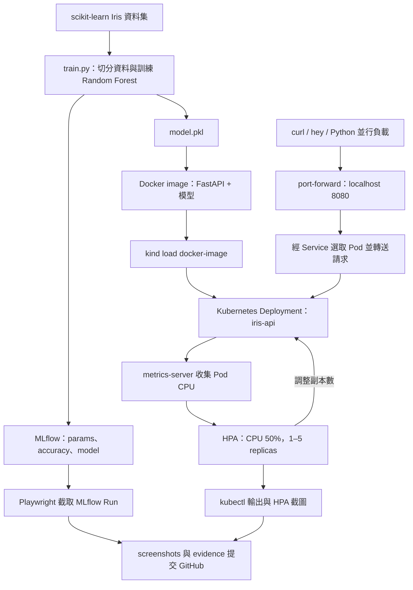
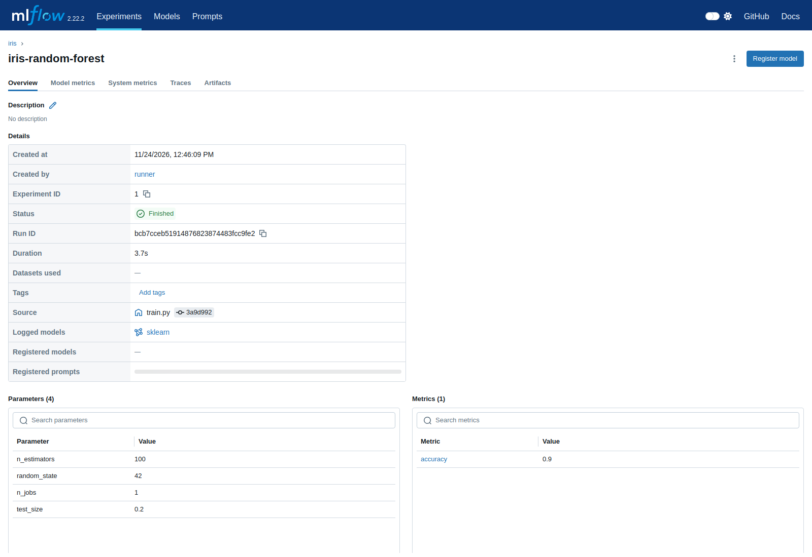
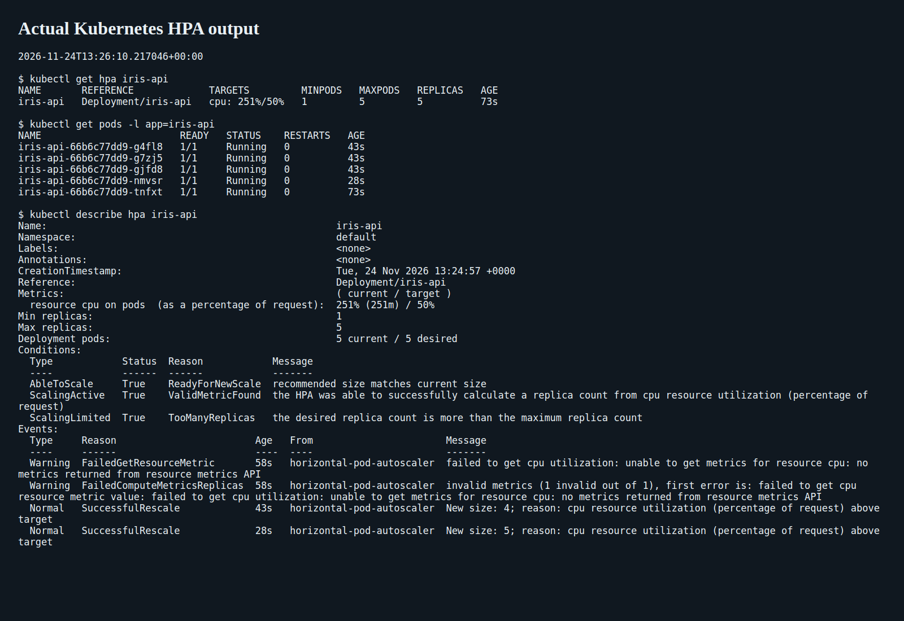

# Lab 1 — Your First Model Service on Kubernetes

依據 MLOps Foundations & Cloud Native AI 講義實際投影片第 49–52 頁實作。

Repository：https://github.com/ronnie-e2714/ossd_lab1

## 作業目標與實作內容

本作業依講義的五個步驟，將 Iris 分類模型從本機訓練轉為可在 Kubernetes 執行的 HTTP 服務，並以實際負載驗證自動擴展。繳交內容包括完整 source code、Kubernetes YAML，以及 MLflow Run 和 HPA Scaling 執行截圖。

| 講義步驟 | 本專案實作 | 驗證方式 |
| --- | --- | --- |
| 1. 建立本機 Kubernetes cluster | 使用 kind 建立 `mlops` 叢集，安裝 metrics-server 提供 CPU 指標；自動驗證時叢集建立於 GitHub runner | 等待 metrics-server 與模型 Deployment rollout 完成 |
| 2. 訓練並追蹤模型 | 使用 scikit-learn 內建 Iris 資料集，訓練 100 棵樹的 RandomForestClassifier；以 MLflow 記錄參數、accuracy、模型與輸入輸出 signature | MLflow Run 顯示 Finished、參數、accuracy 與 logged model |
| 3. 包裝模型服務與映像 | FastAPI 啟動時載入 `model.pkl`，提供 `/predict` 和 `/healthz`；以 Python 3.12 建置 `iris-api:v1` 並載入 kind | API 測試、Docker build 與 HTTP 預測請求 |
| 4. 部署 Deployment + Service | Deployment 初始 1 個副本；ClusterIP Service 將 80 port 導向容器 8080；設定 readiness / liveness probes | rollout 成功，透過 port-forward 呼叫預測服務 |
| 5. 設定資源與 HPA 並產生負載 | CPU request 100m、limit 500m，memory request 128Mi、limit 256Mi；HPA CPU 目標 50%，副本範圍 1–5 | 50 並行、300 秒的真實預測負載，記錄 HPA 指標、Pod 狀態與擴展事件 |

訓練使用固定 `random_state=42` 與分層切分，150 筆資料分為 120 筆訓練及 30 筆測試。MLflow experiment 名稱為 `iris`，Run 名稱為 `iris-random-forest`；參數包含 `n_estimators`、`random_state`、`n_jobs` 與 `test_size`。訓練後同時輸出供服務載入的模型及可查核的 JSON 紀錄。

FastAPI 的 `POST /predict` 接收 `instances` 二維陣列，每筆必須是 4 個有限數值，每次接受 1–1024 筆資料，回傳對應的分類編號。`GET /healthz` 使用非阻塞的 async handler，供 Kubernetes 探針檢查服務，避免與同步推論共用執行緒池；readiness 與 liveness 的逾時皆為 5 秒；模型在服務啟動階段載入，若檔案缺失則啟動失敗。容器以非 root 使用者執行，執行階段只安裝推論所需套件。

## 系統運作流程（Workflow）



模型只在訓練步驟產生，推論容器不重新訓練；MLflow 負責實驗紀錄，FastAPI 負責載入已訓練模型並處理預測。HPA 依 metrics-server 的 CPU 指標調整 Deployment 副本數。本作業的 port-forward 會選取單一 Pod，適合展示負載引發擴展，不作為多副本負載平衡的驗證。

## 各檔案用途

| 檔案 | 描述 |
| --- | --- |
| [train.py](train.py) | Iris 模型訓練入口；設定切分與模型參數、記錄 MLflow 實驗、輸出 `model.pkl` 及 `evidence/training.json`。可透過 CLI 調整樹數、seed、tracking URI 與模型輸出路徑。 |
| [app.py](app.py) | FastAPI 推論服務；啟動時由 `MODEL_PATH` 或預設 `model.pkl` 載入模型，驗證輸入並提供 `/predict`、`/healthz`。 |
| [Dockerfile](Dockerfile) | 以 `python:3.12-slim` 建立推論映像，安裝 runtime 套件、複製程式與模型，以 Uvicorn 監聽 8080。 |
| [requirements.txt](requirements.txt) | 固定 FastAPI、Uvicorn、scikit-learn、joblib 版本，供本機與容器推論使用。 |
| [requirements-dev.txt](requirements-dev.txt) | 引入 runtime 套件，另安裝 MLflow、相容的 SQLAlchemy、pytest 和 httpx，供訓練與測試使用。 |
| [deployment.yaml](deployment.yaml) | 定義 `iris-api` Deployment 和 ClusterIP Service，包含映像、標籤、資源 requests / limits、健康探針及 port 對應。 |
| [hpa.yaml](hpa.yaml) | 使用 `autoscaling/v2` 定義 HPA，目標為 `iris-api` Deployment，CPU 平均使用率 50%，最少 1、最多 5 個副本。 |
| [scripts/deploy.sh](scripts/deploy.sh) | 建立 kind 叢集、安裝與設定 metrics-server、建置並載入映像、套用 YAML，等待部署完成；任一步驟失敗即停止。 |
| [scripts/load.py](scripts/load.py) | 使用多執行緒持續發送 HTTP 預測請求並驗證回應，輸出成功／錯誤次數；可調整 URL、秒數與並行數，若無成功請求或發生任何錯誤則回傳失敗；限制秒數及並行數為正數，連線失敗時稍作退避。 |
| [scripts/capture.py](scripts/capture.py) | 每 10 秒查詢 HPA 與 Deployment，最多等待 240 秒；記錄狀態歷程和 kubectl 輸出，以 Playwright 截取 MLflow UI 及原始 HPA 輸出的瀏覽器畫面。未觀察到至少 2 個 current replicas 和 2 個 ready replicas 時回傳失敗。 |
| [tests/test_app.py](tests/test_app.py) | 6 項 API 測試：健康檢查與正常預測，以及空陣列、欄位不足、欄位過多、非有限數值、超過批次上限的拒絕行為；使用暫存測試模型。 |
| [tests/test_training.py](tests/test_training.py) | 執行真正的訓練入口，確認 MLflow Run 完成、參數與 accuracy 正確，重新載入 MLflow artifact 與本機模型，比對預測及測試集分數。 |
| [.github/workflows/lab.yml](.github/workflows/lab.yml) | GitHub Actions 自動驗證流程，串接套件安裝、測試、訓練、部署、負載、截圖、artifact 上傳及證據提交。 |
| [.dockerignore](.dockerignore) | 僅允許 Dockerfile、runtime requirements、API 程式與模型進入 build context，排除不需要的檔案。 |
| [.gitignore](.gitignore) | 排除虛擬環境、Python 快取、模型、MLflow 資料庫／artifact 目錄與暫存日誌。 |
| [screenshots/mlflow-run.png](screenshots/mlflow-run.png) | 實際 MLflow Run 截圖，顯示完成狀態、參數、模型與 accuracy。 |
| [screenshots/hpa-scaling.png](screenshots/hpa-scaling.png) | 實際 kubectl 輸出的瀏覽器截圖，顯示 HPA、Pod 狀態與自動擴展事件。 |
| [screenshots/README.md](screenshots/README.md) | 說明兩張截圖的來源、內容與成功執行連結。 |
| [evidence/training.json](evidence/training.json) | 訓練 Run ID、accuracy、模型參數、訓練及測試資料筆數。 |
| [evidence/hey.txt](evidence/hey.txt) | 講義指定的 hey 負載測試原始輸出（60 秒、50 並行）。 |
| [evidence/load.json](evidence/load.json) | 負載測試成功與錯誤請求總數。 |
| [evidence/hpa-history.json](evidence/hpa-history.json) | 帶時間戳記的 HPA 與 Deployment 狀態觀測序列。 |
| [evidence/hpa.txt](evidence/hpa.txt) | `kubectl get hpa`、`get pods`、`describe hpa` 的原始查詢輸出。 |
| [README.md](README.md) | 作業要求對照、實作內容、流程、檔案說明、重現步驟及驗證結果。 |

`model.pkl`、`mlflow.db` 與 MLflow artifact 目錄是執行時產物，不納入 Git。先執行 `python train.py` 才能建立含模型的 Docker 映像；MLflow UI 與截圖程式需在同一專案工作目錄使用該次訓練的資料庫。

## GitHub Actions Workflow

流程名稱為 **Lab 1 execution and evidence**，設定於 [.github/workflows/lab.yml](.github/workflows/lab.yml)。推送 `main` 或手動 `workflow_dispatch` 時執行；若推送只變動 `screenshots/**`、`evidence/**`，則不觸發。執行環境為 Ubuntu 24.04、Python 3.12，整個 job 最長 20 分鐘。

| 順序／Step | 工作內容 | 產出或完成條件 |
| --- | --- | --- |
| 1. Checkout / Setup Python | 取得 Repository 原始碼，清除舊 PNG 與 evidence 檔案，設定 Python 3.12 與 pip cache | 可重建的 Python 執行環境 |
| 2. Install dependencies | 安裝 `requirements-dev.txt`、Playwright 1.51.0、Chromium 與瀏覽器系統依賴 | 訓練、API 測試與截圖套件可用 |
| 3. Test and train | 先執行 `python -m pytest -q`，通過後執行 `python train.py` | 7 項測試（6 項 API、1 項訓練整合）通過，產生模型、MLflow Run 與訓練紀錄 |
| 4. Install kind / Install hey | 安裝 kind v0.27.0 與 hey v0.1.4 | 可建立容器化 Kubernetes 叢集 |
| 5. Deploy | 呼叫 `scripts/deploy.sh`，建立 Kubernetes 1.32.2 叢集、metrics-server、映像與應用資源 | metrics-server 與 iris-api rollout 成功 |
| 6. Load test and capture real evidence | 背景啟動 MLflow UI 和 port-forward，等待健康檢查，發送 curl 請求，先跑 hey 60 秒／50 並行負載，確認全為 HTTP 200 且無連線錯誤後，再啟動 300 秒 Python 負載與截圖程式 | 健康檢查逾時即失敗；驗證 HPA 擴展、產生兩張 PNG 和紀錄，等待 Python 負載完成並確認零錯誤 |
| 7. Print runtime diagnostics / Save artifacts for diagnosis | 以 `if: always()` 印出負載／HPA／Pod 診斷，收集 `screenshots/`、`evidence/` | 上傳 `lab1-evidence` artifact；失敗執行的產物僅供診斷 |
| 8. Commit verified evidence | 前置步驟成功才執行 `git add`、commit 和 push | 截圖與紀錄寫回 Repository，供作業檢閱 |

Workflow 使用 `contents: write` 權限寫入證據，提交訊息包含 `[skip ci]`，避免證據提交再啟動同一流程。每次開始先清除舊證據，避免失敗執行的 artifact 混入上次結果。任一測試、訓練、部署或擴展驗證失敗，都不會執行最後的成功證據提交；可由 Actions 日誌與 artifact 查明原因。GitHub runner 上的叢集是該次驗證使用的暫時環境，工作結束後不提供常駐預測服務。

## 繳交內容與驗證狀態

| 要求 | 檔案 |
| --- | --- |
| scikit-learn 訓練、MLflow params / metrics / model | `train.py` |
| FastAPI 預測與健康檢查 | `app.py` |
| Docker 容器 | `Dockerfile`, `requirements.txt` |
| Kubernetes Deployment + Service | `deployment.yaml` |
| CPU 50%、1–5 replicas 的 HPA | `hpa.yaml` |
| 自動部署、負載、蒐證 | `scripts/`, `.github/workflows/lab.yml` |
| MLflow Run 截圖 | 已提交 `screenshots/mlflow-run.png` |
| HPA Scaling 截圖 | 已提交 `screenshots/hpa-scaling.png` |

**2026-11-24 的端到端驗證成功。** 6 項 API 測試、1 項模型重新載入測試、MLflow 訓練、Docker 建置、kind 部署、負載測試及截圖提交均通過。[GitHub Actions 執行紀錄](https://github.com/ronnie-e2714/ossd_lab1/actions/runs/45402584207)

- MLflow Run：`9fd2ea3e749e4c2eb1059e80148be605`，accuracy **0.90**，120 筆訓練／30 筆測試，模型 artifact 已記錄。
- 300 秒、50 並行負載：**24,624 次成功，0 次錯誤**，見 [原始結果](evidence/load.json)。
- HPA 從 1 個副本擴展至 5 個，截圖顯示 5 個 Pod 全部 Ready、重啟次數為 0。CPU 使用率為 request 的 251%，目標為 50%。[原始輸出](evidence/hpa.txt) · [觀測歷程](evidence/hpa-history.json)
- `hey` 以 50 並行執行 60 秒，5,188 次回應均為 HTTP 200。[原始結果](evidence/hey.txt)
- 執行環境為 GitHub-hosted Ubuntu 24.04 / Python 3.12 / kind Kubernetes 1.32.2，解決本機受限環境無法連線 PyPI 與缺少 Docker 的問題。已固定 SQLAlchemy 2.0.40，修正 MLflow 2.22.2 與新版 SQLAlchemy 的相容性問題。

HPA 圖片是實際 `kubectl` 輸出在瀏覽器中的截圖，保留原始時間、replicas、CPU 指標及事件，沒有改寫數值。初期 metrics-server 尚未收集資料的 warning 也如實保留，後續 `ScalingActive=True` 與 `SuccessfulRescale` 證實自動擴展成功。

### MLflow Run



### HPA Scaling



## 執行環境

Python 3.12、Docker Engine（Windows 可用 Docker Desktop Linux containers）、kind、kubectl。安裝套件需能連線 PyPI；建立叢集需能下載容器映像。`scripts/deploy.sh` 在 Bash / WSL / Linux 執行。以下完整重現指令以 Bash / WSL / Linux 為準；Windows PowerShell 可執行 Python、Docker 與 kubectl，但虛擬環境啟用、curl JSON 引號和背景執行需使用對應語法。

```bash
python -m venv .venv
source .venv/bin/activate
# PowerShell: .\.venv\Scripts\Activate.ps1
pip install -r requirements-dev.txt
python -m pytest -q
python train.py
mlflow ui --backend-store-uri sqlite:///mlflow.db --host 127.0.0.1
```

開啟 http://127.0.0.1:5000，在 `iris` experiment 的 run 查看 `n_estimators=100`、`random_state=42`、`accuracy` 與 `model` artifact。訓練採 80/20 分層切分，輸出 `model.pkl` 和 `evidence/training.json`。模型與本機 MLflow DB 不提交，執行訓練即可重建。訓練與容器使用同一版 scikit-learn，避免模型版本不相容。

另開終端測試 API：

```bash
uvicorn app:app --host 127.0.0.1 --port 8080
```

保留服務終端，另外開一個終端發送請求（以下 curl 語法使用 Bash）：

```bash
curl -X POST http://127.0.0.1:8080/predict -H 'Content-Type: application/json' -d '{"instances":[[5.1,3.5,1.4,0.2]]}'
```

預期回應 `{"predictions":[0]}`（此為預期格式，實際結果以執行證據為準）。每筆輸入依序是 sepal length、sepal width、petal length、petal width，單位 cm；0/1/2 分別為 setosa/versicolor/virginica。不合格輸入回傳 422。

## 部署與 HPA

先停止本機 uvicorn，釋放 8080。全新 lab 叢集可直接執行：

```bash
bash scripts/deploy.sh
kubectl port-forward svc/iris-api 8080:80
```

腳本建立獨立 `mlops` kind 叢集並切換到 `kind-mlops` context，安裝 metrics-server v0.7.2，建置及載入 `iris-api:v1`，套用 Deployment、Service 與 HPA。重跑時若叢集已存在，跳過建立步驟，手動執行後續命令；不要對其他叢集套用作業檔。

kind 的本機 kubelet 憑證需在 metrics-server 加入 `--kubelet-insecure-tls`；此設定僅用於本機 lab。CPU request 為 100m，HPA 50% 是相對於 request 計算，約為每 Pod 50m，不是整台主機 CPU 的 50%。資源與自動擴展機制參考 [Kubernetes HPA 文件](https://kubernetes.io/docs/concepts/workloads/autoscaling/horizontal-pod-autoscale/) 與 [metrics-server 文件](https://github.com/kubernetes-sigs/metrics-server)。

另開兩個終端：

```bash
python scripts/load.py --seconds 300 --concurrency 50
```

```bash
kubectl get hpa iris-api -w
# 另外查看：
kubectl get pods -l app=iris-api
kubectl describe hpa iris-api
kubectl top pods
```

也可使用講義的 hey：

```bash
hey -z 180s -c 50 -m POST -T application/json -d '{"instances":[[5.1,3.5,1.4,0.2]]}' http://localhost:8080/predict
```

`port-forward` 會綁定一個 Pod，足以觸發作業的 HPA 示範，但不等於驗證 Service 的負載平衡。短時間負載未必達到 5 replicas；至少觀察從 1 擴為 2 以上。停止負載後，預設縮容穩定視窗約 5 分鐘。CPU 顯示 `<unknown>` 時先檢查 metrics-server rollout、`kubectl top pods` 及 HPA conditions。

## 自動產生及上傳截圖

推送 main 後，在 Repository → Actions → **Lab 1 execution and evidence** 查看執行。也可按 Run workflow 重跑。流程會跑 API 測試、訓練、kind 部署、真正的 HTTP 負載，以及 Playwright 截圖；成功才 commit 截圖與原始紀錄。若 Repository 禁止 workflow 寫入 contents，需調整 Actions 權限或下載 `lab1-evidence` artifact 後自行提交。

本機也可在 MLflow UI、port-forward、負載均執行中時蒐證：

```bash
pip install playwright==1.51.0
playwright install chromium
python scripts/capture.py
```
